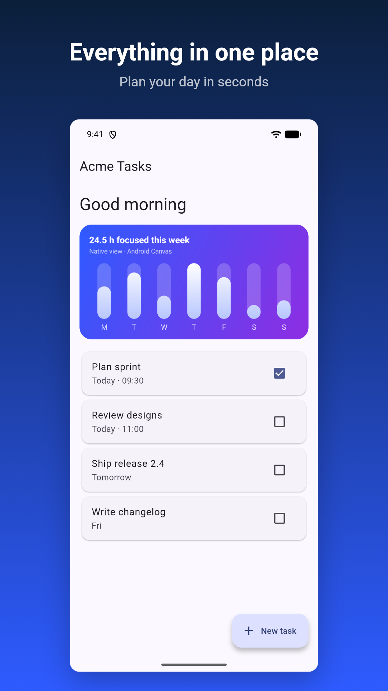

# brandify

**Status: 0.1.0, the first release.** Capture, framing and export work on Android emulators and iOS
simulators. Export writes the folders fastlane uploads from; uploading them with `supply` /
`deliver` has not been tried yet.

brandify turns your Flutter app into store screenshots taken from a **real simulator or emulator**,
driven by an `integration_test` script and run unattended with one command:

```bash
dart run brandify build    # capture → frame → export
```

## Why real capture

If your app embeds native views (`PlatformView`: native 3D, maps, camera previews, native ads, WebView,
video players), **widget-test rendering gives you a black hole and doesn't tell you.** In our evaluation
on a production Flutter app with native 3D rendering via `PlatformView`, app_deploy_screenshots rendered the 3D region as solid `#000000`,
with no placeholder and no warning, and wrote the PNG before the `MissingPluginException` surfaced. The
widget-test environment has no `flutter/platform_views` implementation on either platform.

brandify captures the device's screen from the host (`adb exec-out screencap`,
`xcrun simctl io screenshot`), so you get:

- **native views**, rendered by the platform;
- the **real system bars** (cleaned up: 9:41, full battery, no notifications) and the real gesture pill;
- the **real device geometry**, and the real keyboard when you ask for it;
- **no Android surface swap** (`convertFlutterSurfaceToImage`), which in-app screenshots need.

What it does **not** give you is sharper Flutter pixels. For plain Flutter content, a widget test with
the right device geometry renders almost the same pixels and is much faster.

## Evidence

- **Native views:** the evaluation above, on a production Flutter app with native 3D rendering.
- **Native views, reproducible:** the [example app](https://github.com/ryanhz/brandify/tree/master/example)'s home screen has a
  chart card drawn by Android `Canvas` / UIKit Core Graphics in a `PlatformView`. brandify captures
  and frames it (below, on Android); a widget-test renderer has no platform views and leaves that
  area blank.
- **Deterministic:** two full runs, each from a **cold emulator boot** (boot, build, 2 locales × 3
  screens, shutdown; 89 s and 78 s), produced **byte-identical PNGs**: all 6 files, every byte.
- **iOS too:** on an iPhone 17 Pro Max simulator (iOS 26.4, Xcode 27.0), 2 locales × 3 screens at
  1320×2868 (the App Store 6.9" slot), clean 9:41 status bar, 2–3 captures per shot including a real
  keyboard animation.
- **The real status bar survives framing:** a real 1080×2400 capture framed onto Google Play's
  1080×1920 canvas keeps the device's own status bar and gesture pill, with nothing drawn on top.
- **Honest about Flutter pixels:** against a widget test with matched geometry, 0.56 % of app-content
  pixels differ slightly and 0.03 % strongly (text antialiasing).



## Requirements

- **Flutter 3.35.3 or newer (Dart 3.9).** `brandify_flutter` depends on
  [app_deploy_screenshots](https://pub.dev/packages/app_deploy_screenshots) `^1.2.1` for framing,
  which sets this floor.
- Android: the Android SDK (emulator, platform-tools) and an AVD.
- iOS: macOS with Xcode and an iOS simulator runtime.

## Installation

In your Flutter app's folder, add both packages as dev dependencies, at the same version:

```bash
flutter pub add dev:brandify dev:brandify_flutter
```

`brandify` is the command line tool (`dart run brandify …`); `brandify_flutter` is the helper your
capture test and the framing step use. Neither ends up in your release app.

## Usage

```bash
dart run brandify init     # writes brandify.yaml and integration_test/brandify_test.dart
dart run brandify doctor   # checks that a capture can run on this machine
dart run brandify build    # all three steps below, in one unattended run
dart run brandify capture  # raw screenshots, from the emulator / simulator
dart run brandify frame    # store slides
dart run brandify export   # into fastlane's folders

dart run brandify rename   # app name, Android package, iOS bundle ID (dry run; --force applies)
dart run brandify icons    # launcher icons from app.logo_path
dart run brandify metadata # store listing text into fastlane's folders
```

`init` picks an existing AVD if it finds one and never overwrites files (`--force` does). It also
writes an `app:` and a `metadata:` block with every field empty and a comment on what goes there;
fill them in, then run `rename`, `icons` and `metadata` yourself. `init` never runs them, and
leaving the blocks empty doesn't stop a capture.

### `brandify build`

Runs capture, frame and export in sequence and stops at the first step that fails, naming it
(`error: build stopped at frame: …`). It takes the options of the three steps: `-d` and `-l` select
devices and locales as for capture, and `--replace` is passed to export. Frame and export then work
on exactly what this capture produced, so older captures of other devices or locales left in
`build/brandify/raw/` are not framed or exported. Run the steps on their own to redo one, e.g.
`frame` after changing a caption.

### `brandify doctor`

Checks Flutter (3.35.3 or newer), that your app depends on `brandify_flutter`, `brandify.yaml` and
the capture test, the Android SDK (`adb`, `emulator`, each configured AVD), Xcode and each configured
simulator, fastlane (optional), and the `app:` and `metadata:` blocks: whether `app.name`,
`app.android_package` and `app.ios_bundle_id` are filled in, whether `app.logo_path` exists and is a
square PNG (and `flutter_launcher_icons` is a dependency), and whether each `metadata:` locale has
what both stores need. Those last checks are warnings: they never stop a capture. The Android SDK is found like Flutter finds it: `$ANDROID_HOME`,
`$ANDROID_SDK_ROOT`, Android Studio's default folder (`~/Library/Android/sdk` on macOS,
`~/Android/Sdk` on Linux, `%LOCALAPPDATA%\Android\Sdk` on Windows), then `PATH`. It only reads: nothing is booted or changed. Every problem comes
with what to do about it, and it exits 1 if a capture would fail.

A device this machine can't run is a warning, not a failure, because `capture` skips it: an iOS
device on a machine without macOS, or an Android device when no Android SDK (`adb`) is found. A device
you name with `-d` is never skipped, by either command:

```bash
dart run brandify doctor -d iphone69    # only this device; fails if it can't run here
```

`brandify.yaml` next to your `pubspec.yaml`:

```yaml
locales: [en-US, de-DE]
devices:
  - id: pixel
    platform: android
    avd: Pixel_8_API_36        # booted headless if not running
  - id: iphone69
    platform: ios
    simulator: iPhone 17 Pro Max
```

`integration_test/brandify_test.dart`, with `brandify_flutter` as a dev dependency:

```dart
import 'package:brandify_flutter/brandify_flutter.dart';

void main() {
  brandifyTest('store screenshots', (tester, shot) async {
    await tester.pumpWidget(const MyApp());
    await shot('home');
    await tester.tap(find.byKey(const Key('add_task')));
    await tester.enterText(find.byType(TextField), 'Buy oat milk');
    await shot('add_task', keyboard: Keyboard.show);
  });
}
```

### Capture

```bash
dart run brandify capture              # every device and locale this machine can run
dart run brandify capture -d pixel -l en-US
```

Each device is booted headless if it isn't running (an AVD cold boot takes a minute or two), cleaned
up (status bar, notifications), used for every locale, then shut down if brandify booted it. Raw
screenshots and a manifest land in `build/brandify/raw/<device>/<locale>/`.

Each locale is its own `flutter test` run. brandify runs `flutter pub get` once, only when
`pubspec.yaml` or `pubspec.lock` changed since the last one, and then runs every test with
`--no-pub`, so a flaky network can't stall a capture halfway through.

### Framing

```bash
dart run brandify frame
```

Frames every raw capture for its store slot (Android: Google Play phone, 7" or 10" tablet by the
device's smallest width, 9:16 at the capture's width, e.g. 1080×1920; iOS: the App Store display
class whose size the capture already has, e.g. 6.9" 1320×2868, 6.3", iPad 13") into `build/brandify/framed/<device>/<locale>/`. Optional `frame:` section:

```yaml
frame:
  template: caption_top                # the slide design (the only one so far)
  caption_area: auto                   # or a share of the height above the phone, e.g. 0.25
  background: ['#0B1F3A', '#2E5BFF']   # one colour, or a top-to-bottom gradient
  device: screen                       # or bezel
  font: fonts/NotoSansSC-Bold.ttf      # caption font, e.g. for CJK
  captions:                            # none, or one per captured locale and shot
    en-US:
      home: {headline: Everything in one place, subheadline: Plan your day in seconds}
      add_task: Add a task             # headline only
```

`caption_top` puts the caption at the top and the whole phone below it, above a bottom margin. Every
slide of a device shows the phone at the same size and place, in every locale: the caption area is
as tall as the device's tallest caption (`auto`), or the share you set. A caption taller than a set
`caption_area` is an error that names the slide, rather than a smaller phone on that slide.

The compositor is [app_deploy_screenshots](https://pub.dev/packages/app_deploy_screenshots)'
`MarketingFrame`, run in a widget test brandify generates on the host. The screen it frames is the
real capture, re-rendered pixel for pixel; brandify never draws a status bar or camera cutout over it.

### Export to fastlane

```bash
dart run brandify export
```

Copies the framed screenshots to where fastlane uploads them from, next to `brandify.yaml`:

| Store | Folder | Tool |
|---|---|---|
| Google Play | `fastlane/metadata/android/<locale>/images/{phone,sevenInch,tenInch}Screenshots/` | `supply` |
| App Store | `fastlane/screenshots/<locale>/` (display class told apart by pixel size) | `deliver` |

- **Names:** `{n}_{name}.png` in the order your test shot them (`1_home.png`, `2_add_task.png`;
  `01_…` when a slot has 10), so both tools upload in that order. When `brandify.yaml` has more
  than one iOS device, App Store names get a device prefix (`iphone69_1_home.png`,
  `ipad13_1_home.png`), whichever devices one export includes (`-d`), so names never change
  between runs.
- **Locales:** your BCP 47 tags are mapped to each store's code: `zh-Hans` → Play `zh-CN`,
  App Store `zh-Hans`; `ja-JP` → App Store `ja`; `he` → Play `iw-IL`; `es-MX` → Play `es-419`.
  brandify never guesses: a tag a store doesn't have (e.g. `de-AT`) is an error until you set it:

  ```yaml
  export:
    output: fastlane                  # default
    locales:
      de-AT: {play: de-DE, app_store: de-DE}
      ur-PK: {play: none}             # leave this locale out of Google Play
  ```
- **Checks:** before writing, every framed image must exist, be newer than its capture and have its
  slot's size; at most 8 per Play device type and 10 per App Store display class. After writing,
  each file is read back: exact slot size, the store's size rules, no alpha channel (both stores
  reject one; opaque RGBA is flattened), Play's 8 MB limit. Warnings for fewer than 2 Play phone
  screenshots, and for App Store sets without the required 6.9"/6.5" iPhone or 13" iPad class.
- **Only its own files:** brandify records what it wrote, with a SHA-256 of each file, in
  `fastlane/.brandify-export.json`; commit it along with the screenshots. On the next export it
  replaces its own earlier set, so a dropped shot doesn't linger. Any other image fastlane would
  upload with the set stops the export and is listed, with nothing touched: an image in a Play
  slot folder, an image of a display class being written in an App Store folder, or a screenshot
  brandify wrote that was edited since. `--replace` deletes them. Images of other display classes
  (e.g. a hand-made iPad set) and text metadata are left alone (`brandify metadata` writes the
  text), and a file outside the set is never overwritten.
- **frameit:** `deliver` uploads only `*_framed.png` files from a folder that has any, so a frameit
  leftover there would silently hide brandify's screenshots. Export treats one as an image that
  doesn't belong (`--replace` deletes it) and rejects shot names that would end in `_framed`.

## App identity and store listing

These commands read the `app:` and `metadata:` blocks of `brandify.yaml`. Run each one yourself,
when you need it. Each checks the fields it needs and names any that are missing before it changes
anything.

```yaml
app:
  name: Acme Tasks                 # shown under the launcher icon
  android_package: com.acme.tasks  # Google Play applicationId
  ios_bundle_id: com.acme.Tasks    # App Store bundle ID; may differ from the Android one
  logo_path: assets/logo.png       # square PNG, 1024×1024, relative to brandify.yaml

metadata:
  en-US:                           # every locale here must be in `locales`
    name: Acme Tasks               # App Store name, Play title (≤ 30)
    subtitle: Plan your day        # App Store subtitle (≤ 30), Play short description (≤ 80)
    description: |                 # both stores (≤ 4000)
      Everything in one place.
    keywords: [tasks, todo]        # App Store only (≤ 100 bytes, comma-joined)
    release_notes: Faster sync.    # App Store "What's New" (≤ 4000), Play changelog (≤ 500)
```

### `brandify rename`

**This edits your Flutter project's `android/` and `ios/` files. Commit before you run it**, so
`git diff` shows what changed and `git checkout` undoes it.

```bash
dart run brandify rename           # dry run: old -> new for each value, and every file it would touch
dart run brandify rename --force   # make the changes
```

It needs `app.name`, `app.android_package` and `app.ios_bundle_id`, and changes:

| | |
|---|---|
| Android package | `applicationId` and `namespace` in `android/app/build.gradle` or `build.gradle.kts`; a leftover `package` attribute in the AndroidManifest.xml files |
| Android sources | the package folder that holds `MainActivity` (Kotlin and Java), moved to the new package's folder with every file in it; `package` and `import` lines of the moved files updated |
| Android name | `android:label` on `<application>`, or the `@string/` resource it points to |
| iOS bundle ID | `PRODUCT_BUNDLE_IDENTIFIER` in `ios/Runner.xcodeproj`; IDs nested under the app's keep their suffix (`<id>.RunnerTests`) |
| iOS name | `CFBundleDisplayName` in `ios/Runner/Info.plist` (the name under the icon) |

Names are escaped for XML and Android resources (`Tom & Jerry's` is fine). What brandify can't
change safely stops it before any file changes: product flavors with their own `applicationId`, bundle
IDs set from build settings (`$(…)`), bundle IDs in the Xcode project that aren't the app's or under
it, or a move that would overwrite a file. Translated app names (`res/values-*/strings.xml`) are left
as they are. Run `flutter clean` afterwards. The Android package and the bundle ID can't change once
the app is on the store, so pick them before the first upload.

### `brandify icons`

```bash
flutter pub add dev:flutter_launcher_icons   # once: brandify icons runs it
dart run brandify icons
```

Checks that `app.logo_path` exists and is a square PNG (smaller than 1024×1024 is a warning), writes
a [flutter_launcher_icons](https://pub.dev/packages/flutter_launcher_icons) config to
`build/brandify/flutter_launcher_icons.yaml`, and runs `dart run flutter_launcher_icons -f` on it. That
replaces the Android `mipmap-*/ic_launcher.png` and iOS `AppIcon.appiconset` images, with the alpha
channel removed for iOS (the App Store rejects it). Nothing else in your project is written; for
adaptive icons or other platforms, use flutter_launcher_icons directly.

Expect more than new images in `git diff` afterwards: flutter_launcher_icons also rewrites
`ios/Runner/Assets.xcassets/AppIcon.appiconset/Contents.json` and adds older icon sizes
(`Icon-App-50x50`, `57x57`, `72x72`). That is how the tool always works, not something brandify
adds. Commit those files along with the icons.

### `brandify metadata`

```bash
dart run brandify metadata                  # both stores, every locale in metadata:
dart run brandify metadata -p ios -l en-US  # only the App Store, only en-US
```

Writes the listing text where fastlane uploads it from:

| Store | Folder | Files |
|---|---|---|
| App Store (`deliver`) | `fastlane/metadata/<locale>/` | `name.txt`, `subtitle.txt`, `description.txt`, `keywords.txt`, `release_notes.txt` |
| Google Play (`supply`) | `fastlane/metadata/android/<locale>/` | `title.txt`, `short_description.txt`, `full_description.txt`, `changelogs/<versionCode>.txt` |

- **Required:** the App Store needs `name` and `description`; Google Play needs `name`, `subtitle`
  and `description`. A missing one, or text over a store's limit, is an error that lists every
  locale and field at once, before anything is written. Optional fields that are empty are skipped.
- **versionCode:** the Play changelog is named after the build number in `pubspec.yaml`
  (`version: 1.2.0+42` → `changelogs/42.txt`), or `--version-code`.
- **Locales** map to store codes as for export, including `export.locales` overrides and `none`.
- **Only its own files**, as for export, in the same `fastlane/.brandify-export.json`: a file it
  didn't write that holds other text (e.g. from `fastlane deliver init`) stops it, and
  `--replace` overwrites it; one that already holds the same text is adopted. When you empty a
  field, the file brandify wrote for it is deleted, so the store doesn't keep the old text. Other
  files in these folders (`copyright.txt`, `review_information/`, images) are never touched.

## Running headless and in CI

Capture needs no window: AVDs boot with `-no-window`, simulators without Simulator.app. On a Linux CI
runner, enable KVM and create the AVD your `brandify.yaml` names; brandify boots it.
brandify's own CI does exactly that on every push, from `flutter create` to `export`:
see [`.github/workflows/ci.yml`](https://github.com/ryanhz/brandify/blob/master/.github/workflows/ci.yml)
and [`tool/e2e.sh`](https://github.com/ryanhz/brandify/blob/master/tool/e2e.sh).

## System dialogs show up too

brandify captures what is really on the screen, including system UI. A fresh iOS simulator shows a
one-time "Speed up your typing by sliding your finger…" panel the first time the keyboard opens, and
a `Keyboard.show` shot then captures that panel instead of the keyboard. Dismiss it once on the
simulator (tap Continue), then capture again; it doesn't come back on that simulator. The same goes for permission prompts
and other first-run dialogs: grant or dismiss them on the device before capturing.
